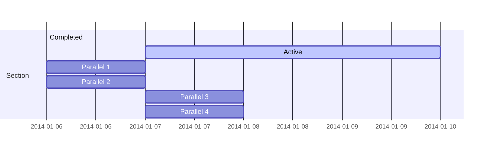

# Using Mermaid-js from md-to-pdf
https://github.com/simonhaenisch/md-to-pdf
https://mermaid.js.org/

# A markdown file with a Mermaid diagram



## Usage
Run
```bash
md-to-pdf --config-file ./config.js ./README.md
```

Note that the diagram is not correctly rendered

Now run
```bash
md-to-pdf --config-file ./config.js ./README.md --as-html
```

Open the resulting html in a browser and note the markdown _is_ correctly rendered.

## Workaround
You can workaround this issue by patching `get-html.js` in md-to-pdf to include the script tags, rather than having them added via the `scripts` 
configuration, which uses puppeteer addScriptTag.