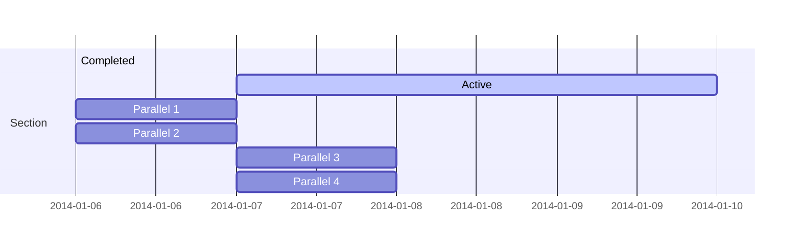

# Using Mermaid-js from md-to-pdf

- Based on this [Gist](https://gist.github.com/danishcake/d045c867594d6be175cb394995c90e2c).
- https://github.com/simonhaenisch/md-to-pdf
- https://mermaid.js.org/

# A markdown file with a Mermaid diagram



## Usage
Run
```bash
md-to-pdf --config-file ./config.js ./README.md
```

